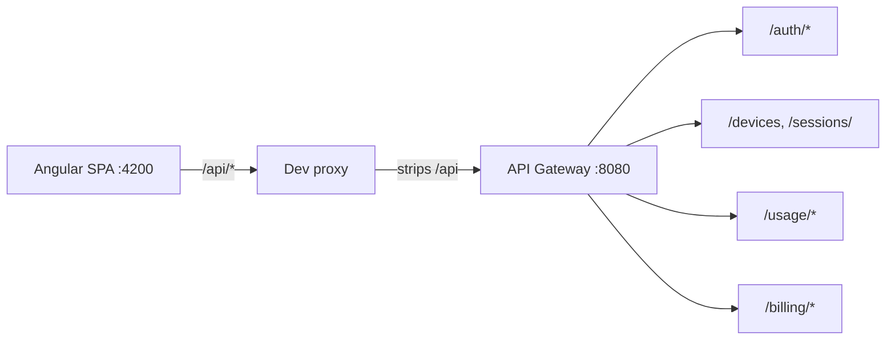
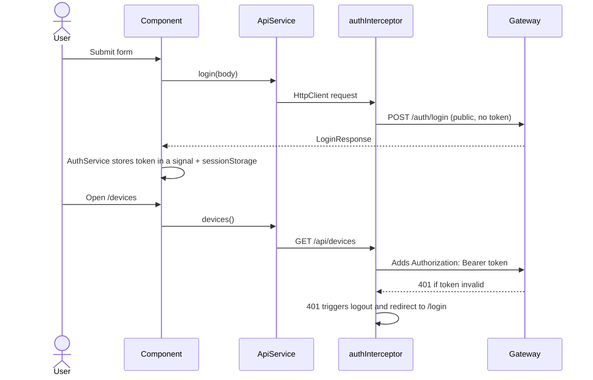

# SaaS Platform UI: Angular Technical Interview Guide

Interview-ready explanation of the Angular concepts used in this repository: what each is, why it is used here, where it lives, and the production limits. **Code is the source of truth**; items not implemented are flagged as such.

Backend context: the UI talks only to the API gateway (`:8080`) of the SaaS platform (auth, device, usage, billing; notification is email-only and has no UI).

## 1. UI at a Glance



| Route | Page | Backend calls | Access |
|---|---|---|---|
| `/login`, `/register` | Login, Register | `POST /auth/login`, `POST /auth/register-tenant` | guests only |
| `/dashboard` | Dashboard | plan, devices, sessions, usage summary | authenticated |
| `/devices` | Devices | device CRUD, start session | authenticated |
| `/sessions` | Sessions | list, end session | authenticated |
| `/usage` | Usage | `GET /usage/summary?period=` | authenticated |
| `/billing` | Billing | plan, invoices, generate | authenticated (generate: admin) |
| `/users` | Users | `POST /auth/users` | admin only |

Structure: [src/app/core](../src/app/core) (API, auth, guards, interceptor), [src/app/layout](../src/app/layout) (shell), [src/app/pages](../src/app/pages) (one standalone component per route).

## 2. Request Flow



## 3. Angular Concepts

### 3.1 Standalone components
**What:** Components declare their own `imports` instead of belonging to an `NgModule`.
**Why:** Less boilerplate, clearer dependencies, and it enables route-level lazy loading of a single component.
**Where:** every file in [pages](../src/app/pages) and [shell.ts](../src/app/layout/shell.ts); bootstrap via `ApplicationConfig` in [app.config.ts](../src/app/app.config.ts).
**Answer:** "No NgModules: each component lists what it uses, and providers are registered in `appConfig`."

### 3.2 Signals and `computed`
**What:** Reactive primitives holding a value; reading them in a template tracks the dependency and updates just that view.
**Why:** Simple local state without manual subscriptions; granular change detection.
**Where:** `AuthService` (`_token` signal; `claims`, `isAuthenticated`, `isAdmin` as `computed`), page state like `devices = signal<Device[]>([])`, and `activeSessions = computed(...)` in [dashboard.ts](../src/app/pages/dashboard.ts).
**Answer:** "`signal` is writable state, `computed` is derived and memoized, `asReadonly()` exposes read access only so components cannot mutate auth state."

### 3.3 `inject()` and dependency injection
**What:** Resolves a dependency from the injector hierarchy. `@Injectable({ providedIn: 'root' })` creates an app-wide singleton, tree-shakable if unused.
**Why:** Testable services and function-based APIs (guards, interceptors) that have no constructor.
**Where:** all services and components; guards and interceptor are plain functions calling `inject()`.

### 3.4 New control flow (`@if`, `@for`, `@empty`)
**What:** Built-in template syntax replacing `*ngIf`/`*ngFor`.
**Why:** No directive imports, better type narrowing, and `@for` requires `track` for efficient DOM reuse.
**Where:** tables with `@for (d of devices(); track d.id)` and `@empty` placeholders; `@if (summary(); as s)` aliases a value.
**Answer:** "`track` gives each row a stable identity so Angular moves DOM nodes instead of recreating them."

### 3.5 Reactive forms and validation
**What:** Form model defined in TypeScript (`FormBuilder`, `FormControl`, `Validators`) and bound to the template.
**Why:** Typed, testable, and validation rules mirror backend constraints (`@Email`, `@Size(min=8,max=72)`, `YYYY-MM` pattern).
**Where:** [login.ts](../src/app/pages/login.ts), [register.ts](../src/app/pages/register.ts), [devices.ts](../src/app/pages/devices.ts), [users.ts](../src/app/pages/users.ts), [usage.ts](../src/app/pages/usage.ts).
**Detail:** `inject(FormBuilder).nonNullable` makes `reset()` return defaults and `getRawValue()` yield non-null types.
**Answer:** "Client validation is a UX convenience; the server validates again and is the authority."

### 3.6 `HttpClient` and a typed API layer
**What:** Observable-based HTTP client. [api.service.ts](../src/app/core/api.service.ts) is the only place URLs are built; models in [models.ts](../src/app/core/models.ts) mirror backend DTO records.
**Why:** One seam to change base URL and one place to mock in tests.
**Note:** Query strings use `HttpParams` so values are encoded.

### 3.7 Functional HTTP interceptor
**What:** `authInterceptor` clones each request to add `Authorization: Bearer <token>` and handles `401`.
**Why:** Cross-cutting concern without touching each call. Requests are immutable, so `req.clone()` is required.
**Where:** [auth.interceptor.ts](../src/app/core/auth.interceptor.ts), registered via `provideHttpClient(withInterceptors([...]))`.
**Detail:** Login/register are skipped so a bad password (401) shows an error instead of logging out; the token is never sent to those public endpoints.

### 3.8 Router, lazy loading, and guards
**What:** Route table with `loadComponent: () => import(...)` creates a separate JS chunk per page. `CanActivateFn` guards run before navigation.
**Why:** Smaller initial bundle; access control at navigation time.
**Where:** [app.routes.ts](../src/app/app.routes.ts), [guards.ts](../src/app/core/guards.ts): `authGuard` (login required), `guestGuard` (hide login when signed in), `adminGuard` (Users page).
**Answer:** "Guards return `true` or a `UrlTree`; returning a UrlTree redirects cleanly. They improve UX only. Real authorization is enforced by the gateway and services (`403`)."

### 3.9 Layout route and `RouterOutlet`
**What:** [shell.ts](../src/app/layout/shell.ts) is a parent route with `children`, rendering the sidebar once and swapping content in `<router-outlet />`. `routerLinkActive` styles the current link.

### 3.10 `withComponentInputBinding`
**What:** Lets route params/query params bind to component `input()`s. Enabled in `app.config.ts` for future detail pages; no current page consumes it.

### 3.11 RxJS interop and `toSignal`
**What:** Converts an Observable to a signal that unsubscribes automatically on destroy.
**Where:** [dashboard.ts](../src/app/pages/dashboard.ts) loads four independent calls; `catchError(() => of(null))` makes one failed backend (for example billing plan not yet created) not break the whole page.
**Contrast:** Other pages call `.subscribe()` for one-shot HTTP requests; these complete automatically, so no leak.

### 3.12 JWT handling on the client
**What:** `AuthService` decodes the payload (base64url) to read `tenantId`, `roles`, and `exp`. It does **not** verify the signature; the client cannot and should not.
**Why:** Show/hide UI by role and detect expiry. The decoded claims are for display only; the server re-validates every call.
**Storage trade-off:** The token is in `sessionStorage` (cleared when the tab closes). Any script injected by XSS can read it. HttpOnly cookies avoid script access but require CSRF protection and backend changes. Angular's default template escaping and sanitization reduce XSS risk; avoid `innerHTML`/`bypassSecurityTrust*`.

### 3.13 Dev proxy instead of CORS
**What:** [proxy.conf.json](../proxy.conf.json) forwards `/api/*` to `http://localhost:8080` and strips `/api`.
**Why:** The gateway has no CORS configuration, and a proxy makes the browser see a same-origin call. It also avoids Angular route names (`/devices`) clashing with API paths.
**Production:** Serve the SPA and gateway behind one reverse proxy/ingress, or add explicit CORS to the gateway. The proxy is a dev-server feature only.

### 3.14 Error handling
**What:** [errors.ts](../src/app/core/errors.ts) maps `HttpErrorResponse` to user-facing text: `status 0` (gateway down), the backend `message`, `403`, and the gateway circuit-breaker `503` fallback.
**Why:** Raw stack traces and internal details are never shown; messages are consistent across pages.

### 3.15 Eventual consistency in the UI
After registration, billing builds its tenant plan from a Kafka event; usage appears after the session-ended event is processed. The UI therefore treats a missing plan or zero usage as a valid temporary state (dashboard fallbacks, Refresh button). It does not poll or use WebSockets/SSE, which is a possible improvement.

### 3.16 Build, bundling, and tooling
Angular CLI with the esbuild-based `@angular/build` builder, TypeScript strict mode, SCSS, and a global stylesheet. Production build: AOT compilation, tree-shaking, minification, and a hashed output in `dist/`. Zone.js change detection is on (`provideZoneChangeDetection`); signals make a later move to zoneless straightforward.

## 4. Interview Questions and Short Answers

**Why standalone components instead of NgModules?**
Less ceremony and explicit dependencies; lazy loading works per component. NgModules are no longer needed for new apps.

**Signals vs RxJS?**
Signals are synchronous state holders with automatic dependency tracking. RxJS models asynchronous streams (HTTP, events, debounce, cancellation). Use RxJS for async, convert with `toSignal` for templates.

**How does change detection work and how do signals help?**
Default: zone.js notices async events and checks the component tree. Signals notify exactly the views that read them, enabling fine-grained updates and OnPush/zoneless behavior.

**What does `track` do in `@for`?**
Defines identity for each item so DOM is reused on list changes. It is mandatory in the new syntax.

**How is auth attached to requests?**
A functional `HttpInterceptorFn` clones the request with the bearer header and logs the user out on `401`, except for public auth endpoints.

**Does the client verify the JWT?**
No. It only decodes claims for UI. Signature validation happens at the gateway and services; client claims can be forged locally, so never use them for security decisions.

**Route guard vs backend authorization?**
A guard prevents navigation and hides UI. An attacker can bypass the browser, so the backend must authorize each request. Here a regular user calling invoice generation gets `403` from the server.

**Where do you store the token and why?**
`sessionStorage` here for simplicity and a shorter lifetime. Trade-off: readable by XSS. Alternative: HttpOnly, Secure, SameSite cookie with CSRF defenses, or a BFF pattern. Refresh tokens do not exist in this backend yet.

**How do you avoid memory leaks with Observables?**
HTTP observables complete. For long-lived streams use `toSignal`, `takeUntilDestroyed`, or the `async` pipe. Never leave manual subscriptions on events/intervals.

**What is lazy loading and how do you verify it?**
Routes use dynamic `import()`, which the bundler splits into chunks loaded on first navigation. The `ng build` output lists lazy chunk files separately.

**Why a proxy and what breaks without it?**
Browser same-origin policy blocks cross-origin calls without CORS headers. The gateway sends none, so the proxy keeps requests same-origin in dev.

**Template-driven vs reactive forms?**
Reactive forms keep the model in code, are typed, easier to unit test, and scale to dynamic validation. Template-driven is fine for tiny forms.

**How do you prevent double submission?**
A `busy` signal disables the button during in-flight login/register; form validity disables others. For writes the backend also needs idempotency (invoice generation is unique per tenant/period).

**How do you handle `401` vs `403`?**
`401`: not authenticated or token expired, so clear the session and redirect. `403`: authenticated but not permitted, so show a message and keep the session.

**How do you handle the backend circuit breaker response?**
The gateway returns `503` with `Retry-After`; the UI shows a retryable message. Automatic retry of writes is avoided to prevent duplicates.

**How would you test this app?**
Unit: services with `HttpTestingController`; interceptor and guards with `TestBed.runInInjectionContext`; components with `ComponentFixture`. E2E: Playwright/Cypress against the Docker Compose stack. **Gap:** only the generated test setup exists; no tests are written yet.

**How would you improve performance?**
`ChangeDetectionStrategy.OnPush` (or zoneless), `track` in lists, `@defer` for heavy blocks, pagination for large invoice/session lists (the backend lists are not paginated), and bundle budgets.

**How does the UI stay secure against XSS?**
Angular escapes interpolations and sanitizes bound HTML/URLs. This app has no `innerHTML` and no `bypassSecurityTrust*`. Add a strict Content-Security-Policy at the web server.

**How would you handle token expiry gracefully?**
Currently `isAuthenticated` checks `exp` and the guard redirects; an expired token during use triggers logout on the next `401`. Better: a refresh-token flow or a timer warning, which requires backend support.

**How would you deploy it?**
`ng build` produces static files; serve via nginx with SPA fallback to `index.html`, route `/api` to the gateway, add security headers, and cache hashed assets long-term.

**How would you add real-time updates?**
Server-Sent Events/WebSocket through the gateway for session/invoice events, or short polling. This is not implemented; today pages refresh on load or via the Refresh button.

**What is `withComponentInputBinding` for?**
Binds route params to component inputs, removing `ActivatedRoute` boilerplate.

## 5. Scenario Questions

| Scenario | Answer |
|---|---|
| Backend is down. | `status 0` is mapped to "Cannot reach the gateway"; dashboard widgets show fallbacks because `catchError` swallows per-call failures. |
| Token expires mid-session. | Next request returns `401`, the interceptor logs out and routes to `/login`. |
| A USER opens `/users` by URL. | `adminGuard` redirects to `/dashboard`. Even if bypassed, the backend returns `403`. |
| User clicks "Generate invoice" twice. | Backend returns the existing invoice for that tenant/period; the list reloads with one invoice. |
| Billing plan is missing right after registration. | Billing receives it asynchronously; the UI shows a dash and the plan appears after the event is processed. |
| Two admins start the same device. | One receives `409 Conflict` from the conditional update, and the UI displays the backend message. |
| Another tenant's ID is typed. | The backend scopes by token tenant and returns `404`; the UI only shows the error. |

## 6. Verification

```powershell
npm.cmd install
npm.cmd start            # http://localhost:4200, needs gateway on :8080
npm.cmd run build        # production build in dist/
```

Backend: `docker compose -f infra/docker-compose.yml up -d --build` in the platform repository. Register a tenant, sign in, add a device, start and end a session, then check Usage and generate an invoice. Notification emails appear in MailHog (`http://localhost:8025`).

## 7. Production Limits (disclose these)

- Token in `sessionStorage`; no refresh token or logout on server side; consider HttpOnly cookies/BFF.
- No automated tests beyond the generated scaffold.
- No pagination, real-time updates, or i18n/accessibility audit.
- Dev proxy only; production needs a reverse proxy or gateway CORS and a Content-Security-Policy.
- Device/session pages display short IDs and do not join device names into session rows.
